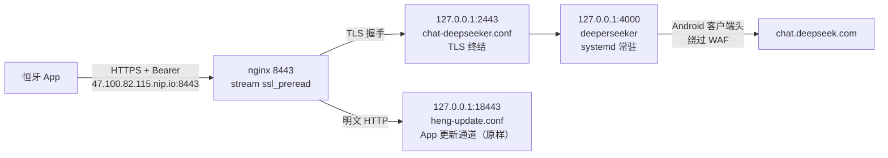
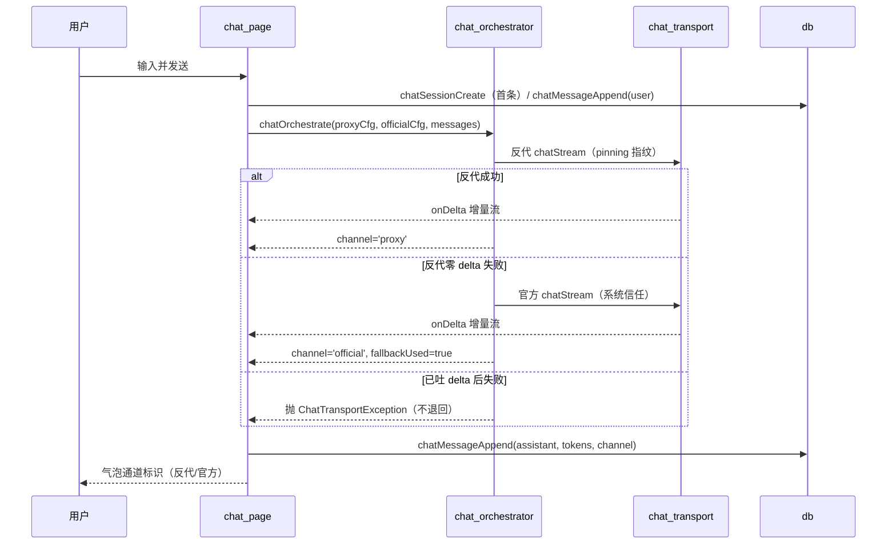

# DeepSeek 双通道聊天 Agent — 实施完结文档

- 项目：恒牙（hengya）App 内置问答 Agent
- 计划书：`docs/deepseek-chat-agent-plan.txt`
- 实施日期：2026-10-11 ~ 2026-10-12
- 版本：原计划 `0.1.23+42`，集成主线其他功能后随 `0.1.24+44` 发版
- 状态：P0 / P1 / P2 / P3 全部完成；与语料库上传查重合并发版

---

## 一、目标达成总览

| 目标 | 计划验收标准 | 结果 |
|---|---|---|
| G1 服务器部署 deeperseeker 反代 | 常驻运行、内存受限、不启用 Playwright | ✅ 达成（systemd + MemoryMax=300M，实测占用约 165M；Playwright 上游已废弃，默认不启用） |
| G2 直接 IP + 密钥访问 | App 可经 HTTPS + Bearer 完成流式对话，无域名/无穿透/无 VPN | ✅ 达成（`https://47.100.82.115.nip.io:8443/v1`，全程 TLS；端口方案因安全组限制由 443 调整为 8443） |
| G3 双通道自动退回 | 反代优先，失败自动退回官方 LLM，UI 标注实际通道 | ✅ 达成（`chatOrchestrate` 编排层 + 气泡通道标识 + 退回 TopToast） |
| G4 LLM 预设统一管理 | 聊天与拆卡共用预设档案，可增删改切换，key 走 AiKeyVault | ✅ 达成（`/settings/presets` 档案池 + 聊天/拆卡双 scope 切换；key 入 vault） |

---

## 二、服务器端改动（P0 / P1）

### 2.1 关键前置发现（与计划书假设的偏差）

1. **deeperseeker 无官方镜像**：官方文档只给 `docker build`（=在服务器编译，违反「不在服务器编译」纪律），备选方案为 pip 直跑 Python 版。→ 采用 uv + 预编译 CPython。
2. **阿里云安全组未放行 80/443**：计划书假设「复用 443 无需改动」，实际自 2026-09-07 起 80/443 全部被安全组挡（TCP 超时），连既有域名 `long.enyghew.cn` 也因此失联。当时维护者已把 App 更新通道迁到 **8443**（已放行）。→ 聊天入口复用 8443。
3. **8443 已被更新通道以纯 HTTP 占用**：nginx 不允许同端口混合 ssl/非 ssl。→ 用 **stream `ssl_preread`** 在 8443 单端口按「是否 TLS 握手」分流。

### 2.2 部署架构

### 2.3 服务器落地清单

| 项 | 位置 | 说明 |
|---|---|---|
| 反代程序 | `/opt/deeperseeker` | `AmanCode22/deeperseeker` v6.0（af80242） |
| Python 运行时 | `/opt/deeperseeker/.venv` | uv 管理的 CPython 3.13.16 + 依赖（`uv sync --frozen`，走阿里 PyPI 镜像） |
| 密钥配置 | `/opt/deeperseeker/.env` | `DEEPSEEKER_API_KEY`（自设 48 位随机）+ 改掉的 admin 口令；`chmod 600` |
| token 池 | `/opt/deeperseeker/deeperseeker.db` | sqlite，重启不丢；当前 1 个小号 token |
| 常驻服务 | `/etc/systemd/system/deeperseeker.service` | `MemoryMax=300M`、`MemoryHigh=250M`、`Restart=on-failure`、开机自启 |
| TLS 终结 | `/etc/nginx/conf.d/chat-deepseeker.conf` | `listen 127.0.0.1:2443 ssl` → `127.0.0.1:4000` |
| 单端口分流 | `/etc/nginx/nginx.conf` | 顶部 `load_module` stream 模块；末尾 `stream { map $ssl_preread_protocol ... }` |
| 更新通道 | `/etc/nginx/conf.d/heng-update.conf` | 仅 `listen 8443` → `listen 127.0.0.1:18443`，URL 与行为零变化 |
| 自签证书 | `/etc/nginx/ssl/chat.crt` / `chat.key` | 10 年期，CN=`47.100.82.115.nip.io`；SHA256 指纹 `3E:5E:57:76:9A:DA:9D:19:6A:5D:EC:37:E0:2F:E6:6B:F0:6C:17:B1:09:60:F6:39:A1:D4:AA:8F:6F:DB:39:E7` |
| 备份 | `nginx.conf.bak-chat-20261011` 等 | nginx 三处改动均有 `.bak-chat-20261011` 备份 |
| 部署文档 | `/opt/deeperseeker/DEPLOY.md` + `docs/deploy/deepseeker-DEPLOY.md` | 运维命令、换 token、升级、风险 |

### 2.4 实测记录

- **P0.3 闸门**：注入小号 token 后 `/health` 由 `degraded` → `ok`；真实流式对话返回正常内容 → **服务器 IP 未被 DeepSeek 风控拦截**（Android 客户端头机制生效），免费通道可行。
- **公网双路径**：`https://47.100.82.115.nip.io:8443/health` → 200；`http://47.100.82.115:8443/<更新路径>/latest.json` → 200（更新通道未受影响）。
- **P1.3 水位**：空闲 + 连续 4 轮对话，内存稳定在 **165M**，系统可用 651M，未影响机上既有服务。
- **端到端**：本机走公网 HTTPS 真实调用 → 流式返回「链路OK」。

---

## 三、App 端改动（P2 / P3）

### 3.1 新增文件

| 文件 | 行数 | 职责 |
|---|---|---|
| `app/lib/services/local/chat/chat_transport.dart` | 226 | 聊天专用 OpenAI 兼容流式客户端：`ChatTransportConfig` / `chatStream`（`onDelta` 打字机 + `onDone` usage）/ `ChatTransportException` / 自签证书 SHA256 指纹 pinning（`pinnedFingerprint`，null=系统信任）/ `hexFingerprint` 归一化 |
| `app/lib/services/local/chat/chat_orchestrator.dart` | 172 | 双通道编排：反代优先 → 零 delta 失败自动退回官方；已吐 delta 后失败不退回；退回写 AppLog；`loadChatProxyConfig` / `loadChatOfficialConfig`（含预设档案消费） |
| `app/lib/pages/chat_page.dart` | 479 | 聊天页：气泡列表 + 打字机流式渲染 + 会话列表/新建/删除 + 通道标识 + 配置未就绪提示 |
| `app/test/chat_transport_test.dart` | 239 | 传输层：SSE 拼接、usage、reasoning 忽略、坏 JSON 跳过、HTTP 错误、空流、未配置 |
| `app/test/chat_orchestrator_test.dart` | 210 | 编排：反代成功不退回 / 零 delta 退回 / 已吐 delta 不退回 / 未配置直官方 / 双失败抛错 |
| `app/test/chat_store_test.dart` | 109 | 存储：建会话、消息顺序与字段、updated_at 排序、删除级联、会话隔离 |
| `app/test/chat_settings_route_test.dart` | 120 | chat 设置路由：http 拒绝、空 model 拒绝、key 空保持、掩码回显、key 不落库 |
| `app/test/chat_presets_route_test.dart` | 214 | 预设路由：建/改/删/切换/掩码/https 校验/引用清理 |
| `app/test/llm_preset_assembly_test.dart` | 205 | 拆卡组装点：presetId 生效、默认 llm.* 直读、档案缺失回退、key 未下发回退 |
| `docs/deploy/deepseeker-DEPLOY.md` | 54 | 服务器部署与运维文档（入仓库） |

### 3.2 修改文件

| 文件 | 改动 | 说明 |
|---|---|---|
| `app/lib/services/local/db.dart` | +156 | 新增 `chat_sessions` / `chat_messages` 两表 + 索引；`chatSessionCreate/Sessions/Rename/Delete`、`chatMessageAppend/Messages`、`ChatMessageRow`（SQL 全参数化） |
| `app/lib/services/local/local_backend.dart` | +244 | `/settings/ai/chat` GET 掩码 + PUT；`/settings/ai/chat/test`；`/settings/presets` 系列路由（列表/建改/删/一键切换）；预设 key 预热 `preset.<id>` |
| `app/lib/pages/about_page.dart` | +512 | 「聊天服务」配置卡 + 「预设档案」底部弹层（`_PresetsSheet` / `_PresetEditSheet`：列表/新建/编辑/删除/用于聊天/用于拆卡，key 掩码） |
| `app/lib/services/local/pipeline_runner.dart` | +69 | 拆卡 `resolveLlmCfg` 接入预设档案（`llm.presetId` 非空且档案存在→读档案，否则维持 `llm.*` 直读）；worker 按需下发 `preset.<id>` key |
| `app/lib/services/api/api_client.dart` | +24 | `kAiServices` 白名单加 `chat`（并补上原缺失的 `llm_backup`）；`AiSettings` 加 `chat` 节点 |
| `app/lib/services/local/ai_key_vault.dart` | +11 | `kAiKeyServices` 加 `chat`（自动纳入预热与迁移） |
| `app/lib/pages/home_page.dart` | +22 | 首页顶部加「AI 问答」圆钮入口 → 打开聊天页 |
| `app/lib/pages/hengya_home_parts.dart` | +4 | chat 服务的默认 baseUrl/model/标题文案 |
| `app/pubspec.yaml` | ±1 | 版本 `0.1.22+41` → `0.1.23+42` |
| `app/test/m5_ai_settings_test.dart` | ±8 | 白名单扩展导致「chat 非法」断言翻转（样本改 `vector`/`dialog`） |
| `app/test/reranker_settings_test.dart` | ±4 | 同上（样本改 `vector`/`nope`） |

### 3.3 核心数据流

### 3.4 预设档案设计

- **存储**：不建新表，复用 settings 键组 `preset.<id>.{name,baseUrl,model,temperature}`；key 存 AiKeyVault svc `preset.<id>`（settings 表只留空键位）。
- **生效选择**：`chat.presetId`（聊天）、`llm.presetId`（拆卡）。
- **默认行为零变化**：拆卡侧 `llm.presetId` 为空时仍读 `llm.*`，生卡流水线默认档案不变。
- **官方退回通道**：恒用 `llm.*`，不受预设影响。

---

## 四、安全红线遵守情况

| 红线 | 遵守情况 |
|---|---|
| App 侧 API key 只进 AiKeyVault | ✅ `chat` / `preset.<id>` 均走 vault；settings 表只留空键位；UI `obscureText`；日志与错误消息不含 key |
| 服务器侧只监听 127.0.0.1，公网仅暴露 8443 + Bearer | ✅ deeperseeker 绑 `127.0.0.1:4000`；TLS 终结在 `127.0.0.1:2443` |
| DeepSeek 网页 token 只存服务器、用小号 | ✅ token 仅存服务器 sqlite；使用小号 |
| 资源约束（mem_limit + 日志轮转 + 不扫盘 + 不服务器编译） | ✅ systemd `MemoryMax=300M`；journald 轮转；uv 拉预编译二进制（无编译）；未全盘扫描 |
| 不动既有容器与配置 | ✅ 1panel / mihomo / cli-proxy-api 未碰；nginx 改动最小化且留备份 |
| 不动 `run_engine.dart` 流水线与 `kFallbackPrompts` 双处同步 | ✅ 未触碰 |
| sqlite3 依赖红线（锁 2.4.0） | ✅ 未动；pubspec 仅改版本号 |
| 本地只跑 `flutter analyze --no-pub lib test` | ✅ 遵守 |

---

## 五、验证记录

| 项目 | 命令 | 结果 |
|---|---|---|
| 静态分析 | `flutter analyze --no-pub lib test`（cwd=app） | `No issues found!` |
| 新增测试 | `flutter test test/chat_*.dart test/llm_preset_assembly_test.dart --concurrency=1` | 39 项全过 |
| 回归测试 | `m5_ai_settings / reranker_settings / local_backend / ai_key_vault / home_page` | 58 项全过 |
| 服务器服务 | `systemctl is-active deeperseeker` / `/health` | `active` / `{"status":"ok"}` |
| 公网 TLS | `curl https://47.100.82.115.nip.io:8443/health` | 200 |
| 更新通道 | `curl http://47.100.82.115:8443/<path>/latest.json` | 200 |
| 端到端对话 | 本机公网 HTTPS 流式调用 | 正常流式返回 |

---

## 六、风险登记（实施后更新）

| 风险 | 概率 | 现状与缓解 |
|---|---|---|
| 服务器 IP 被 DeepSeek WAF 拒 | — | 已实测放行（P0 闸门通过）；若日后收紧，双通道自动退回官方 |
| 逆向协议失效（DeepSeek 改版） | 随时 | 双通道自动退回兜底；等 deeperseeker 上游更新 |
| 1.6G 内存被挤爆 | 低 | MemoryMax=300M + 实测 165M 水位 |
| 账号被封 | 中 | 小号；token 池可扩（`/tokens/add`） |
| 自签证书轮换需同步发版 | 低 | 10 年期；轮换时须更新 `kChatProxyCertSha256` 并重新发版 |
| 安全组始终未放行 80/443 | 中 | 当前方案不依赖；若日后放行可平滑迁回 443 + Let's Encrypt |

---

## 七、待办与后续

1. **提交与发版**：改动尚未 commit。发版流程 = commit → `git tag v0.1.23` → push（含 tag）→ CI 构建 APK 与全量测试 → 草稿 Release。
2. **P4 Agent 能力（未开展）**：
   - P4.1 语料检索注入：聊天页检索开关 → `corpusSearch` top-k 拼 system → 引用来源条（`chat_messages.refs` 字段已预留）。
   - P4.2 深夜 digest：定时任务拉当日对话 + 复习统计 → 生成掌握摘要 → 次日注入上下文。
3. **可选加固**：聊天页 UI 层暂无 widget 测试覆盖（仅路由层有测试）。
4. **可选优化**：若安全组放行 80/443，可迁回标准 443 + Let's Encrypt（省去自签证书轮换约束）。

---

## 八、关键决策记录

| 决策 | 理由 |
|---|---|
| 用 uv + 预编译 Python 3.13 直跑，而非 Docker | 项目无官方镜像；`docker build` 违反「不在服务器编译」；Docker Hub 直连不通 |
| 聊天入口用 8443 + stream `ssl_preread` 分流 | 安全组未放行 80/443；8443 已放行且被更新通道占用；分流让两者共存且更新通道 URL 零变化 |
| 用自签证书 + App 指纹 pinning，而非 Let's Encrypt | HTTP-01 验证必须走 80/443（不可用）；nip.io 无法 DNS 验证；指纹 pinning 对 App 无感 |
| 聊天传输层独立于 `run_llm.dart` | 拆卡的失败语义（token 熔断/failover/降级梯）不适用于聊天；避免耦合，红线文件零改动 |
| 预设档案复用 settings 键组而非新建表 | 最小改动；复用 AiKeyVault 与现有导出剥离逻辑 |
| 拆卡预设默认不启用 | 保证生卡流水线默认行为零变化（计划书要求） |
