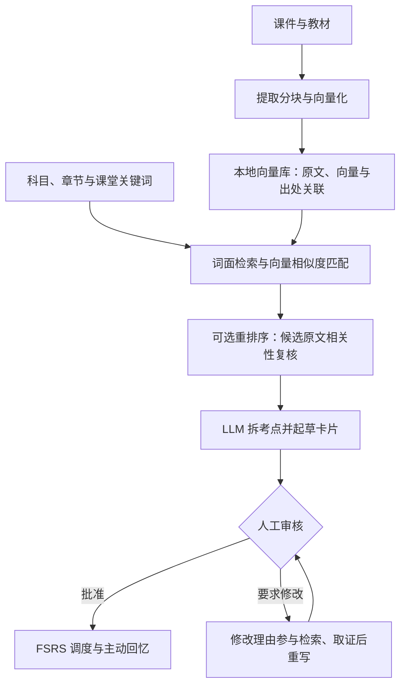

> **先下载恒牙，带上一份你正在学的课件，试试它怎样「按意思找原文，再把原文变成复习卡」：[获取 Android App](https://github.com/long2004at/hengya/releases "恒牙公开发布页，可查看版本并获取 Android 安装包")。**

# 恒牙（Hengya）——AI 负责做卡，你负责记住

> 知乎黑客松项目说明书｜Android · 本地优先 · MIT 开源  
> 给自己的资料建立向量库，让课堂关键词变成有出处、可复习的知识。

**课听懂了，PPT 收藏了，考试前却还是要从头整理。**

很多学习者并不缺资料，也知道主动回忆、间隔复习这些方法。真正难的是中间那一步：把几十页课件变成值得反复练习的问题。手工做卡费力，直接让 AI 出题又不敢放心背；即使整理好了，还要决定今天复习什么。

恒牙想把这段路接起来：你提供自己的课件、教材和课堂关键词，AI 负责查资料、拆考点、起草卡片；你核对、修改、批准，App 再安排后续复习。

**最值得体验的，不只是 AI 会出题，而是它给你的资料建立了一座「按含义查找」的向量库：向量模型大范围寻找相关片段，词面检索补充精确术语，重排序模型再做一轮相关性复核，最后才交给大模型制卡。**

这意味着，你不必先猜中教材的原句，才有机会找到那一段知识。恒牙把专业的语义检索能力，落到普通人的一份课件、一个课堂关键词和每天的复习里。

**记关键词 → 词面与向量检索 → 可选重排序精排 → AI 拆卡 → 人工审核 → 间隔复习。**

---

## 一、先看一节课，会发生什么

恒牙从口腔医学课程的复习需求出发。以一节龋病课为例，你在收件箱里留下：

> **课程**：牙体牙髓病学  
> **章节**：龋病  
> **关键词**：四联因素、按累及深度分类、深龋治疗原则

你不需要先写一份工整笔记，也不需要设计提示词。导入相应资料、触发拆卡后，系统围绕这些线索查找课件与教材，组织成可以独立作答的卡片，例如：

- 「龋病病因的四联因素学说包括哪四个因素？」
- 「按累及深度，龋病分为哪三类？」
- 「深龋的治疗原则是什么？」

**重点不只是「题出好了」，而是接下来的三个动作也有去处：**

1. **这张卡可信吗？** 查看答案及来源锚点，回到对应资料核对。
2. **这张卡不合适怎么办？** 直接编辑，或写明理由送回 AI 重做；改完仍需审核。
3. **审核完会不会又被忘在收藏夹？** 批准后进入复习队列，根据你的作答评分计算下一次到期时间。

上面是流程与问法示意，并非某次模型运行的实测输出；实际题目、答案和来源定位取决于导入资料与模型结果。

**从「我把这节课存下来了」，走到「我现在可以考考自己了」——这才是恒牙希望带来的变化。**

## 二、核心亮点：让你的资料不只「能存」，还能够「按意思被找到」

### 1. 向量模型怎样处理资料？给每段原文一组「语义坐标」

App 先提取课件、教材中的文字，切成适合检索的片段，再交给向量模型（Embedding），把每段内容转成一组数字。这组数字就是**向量**，可以把它理解为这段话在「含义地图」上的坐标：表达的意思越接近，向量通常越相近。

例如，「蛀牙为什么会发生」与「龋病病因」用词不同，却指向相近主题。向量检索要解决的，正是**没有写出同样几个字，也能寻找相关原文**的问题，而不是只做一次 Ctrl+F。这个例子用于说明语义匹配，实际命中仍需结合资料核对。

### 2. 向量库是什么？一座有原文、有出处的私人资料地图

这些向量不是生成后就丢掉，而是与**原文片段、文件名、页段、所属科目及资料类型**关联，保存在手机的 SQLite 语料库中，形成可复用的本地向量库。它不是聊天记录，也不是把教材「训练进模型脑子里」，而是让以后每次查找都有现成的语义索引可用。

当你输入关键词，系统使用与建库匹配的向量模型把查询也转成向量，在相应资料范围内比较相似度，再沿关联关系取回原文。**向量负责找到方向，原文负责提供依据。**

### 3. 高强度检索，不是把整本书反复塞进聊天框

恒牙让两条检索路线互补：**词面检索抓住专业术语，向量检索寻找含义相近的片段**，再融合排序。若原句找不到有效资料，还会依次尝试「科目名 + 当前章节」和 LLM 生成的同义表达；前一级命中，就不再继续扩展。

这种检索强度来自对语料库的相似度计算、多路匹配与逐级补查，而不是让大模型一次吞下所有资料。已经建立的向量可以反复使用，建库也支持按内容指纹跳过未变化的嵌入任务。

### 4. 重排序为什么值得多加一层？「意思接近」不等于「能回答这道题」

向量模型先从大范围资料中找候选；启用**重排序模型（Reranker）**后，再把「查询 + 候选原文」交给它逐段评估相关性，重新排定顺序。当前精排窗口最多取 20 条候选，集中把计算用在最值得复核的片段上。

可以把它理解为：**第一位管理员帮你找出可能相关的书页，第二位复核者再判断哪几页更贴近这次的问题。** 这是一层有意保留的冗余核验：不让首轮相似度排名直接决定全部证据，也不把检索与制卡都压在一个模型身上。

重排本身也有降级设计：配置模型不可用时会尝试后备模型；均不可用时沿用原有融合排序，不让增强环节拖垮整条流程。**重排是可选的相关性复核，不是事实正确性的保证。**

### 5. 找到证据之后，才轮到大模型出卡

课件与教材分别检索后组成双源证据池，生成规则要求内容冲突时以教材为准；真题走独立候选通道，考纲用于范围与标签等辅助信息，不混作真题答案来源。有匹配证据时，程序将片段编号映射回文件与页段，形成卡片的来源锚点。

随后，LLM 按「子考点计划 + 卡片」两段式输出，围绕完整设问拆卡；题干还会接受向量相似度检查，疑似重复时提示用户比较裁决。新卡和回炉卡都需要人工审核，批准后才进入正常复习。

**向量模型找资料，重排序模型筛证据，大语言模型编卡片，人决定是否值得背。**

## 三、四个值得亲手体验的细节

### 1. 不只给答案，还留下「回去核对的路」

在医学学习中，一句流畅但错误的解释，不值得被反复记忆。

恒牙将检索到的原文片段作为制卡依据。有匹配证据时，卡片携带文件名、页码或页段等来源锚点；未找到有效资料时，提供「语料未覆盖／待补原文」提示与占位卡，提醒用户补充，而不是把缺资料伪装成已经解决。

**有出处不等于必然正确，但它让核验有了抓手。** 定位精度受原始文档与提取结果影响；检索、重排、规则检查与人工审核共同降低错误风险，但不构成「零幻觉」保证。

### 2. 「按教材改」不只是聊天意见，而是下一轮查证的线索

不满意一张卡时，你可以写下「请按教材核对这一定义」之类的理由。

恒牙的回炉机制不只是把旧答案再润色一次：它会重新检索课件和教材，并将理由、留言加入教材侧的补充检索，再交给 LLM 重写，最后送回待审池。

**你的反馈影响的不只是措辞，还有 AI 下一次去找什么证据。** 这是从「生成一次」走向「可纠正的学习材料」的关键，并不意味着模型被微调或永久学会了用户偏好。

### 3. 学到哪一章，与哪张卡快忘了，是两件不同的事

恒牙用两套机制分别处理：

- **学习罗盘**记录课程章节进度，让你看见已学范围和下一章；常规真题周扫以已学章节为检索起点，把课堂学习与考试练习接起来。
- **FSRS 间隔复习调度**根据每张卡的作答评分更新到期时间。你选择「重来／困难／良好／简单」，系统据此调整这张卡下一次出现的间隔。

前者回答「我学到哪里了」，后者回答「我今天该复习什么」。不是给所有人发同一套每日题，也不是让大模型凭感觉安排复习。

### 4. 一个可以用手感受到的设计：先想，再擦开答案

复习时最容易发生的错觉，是一看到答案就觉得「这个我会」。

恒牙提供可选的**「答案雾」**：翻面后，答案仍被一层纸雾遮住。你可以先回忆，再用手指逐步擦开核对，也可以掀开纸角一次看全。它默认关闭，不强迫每个人改变习惯。

这个小交互与整个项目的取舍一致：**AI 可以帮你把材料准备好，但回忆的那一下，应该留给你。**

## 四、对评委而言，项目的价值在哪里

### 将向量检索与重排序，落到普通人每天会遇到的问题上

用户不需要理解向量维度、相似度算法或精排接口，也能把自己的资料变成可按含义检索的知识库。模型能力不再只是开发者工具里的一个 API，而是「用自己的话记重点，也有机会找回教材依据」的具体体验。

**新颖之处在于这套检索能力的落地方式：从私人语料建库，到多层检索，再到可核验、可修订、可复习的卡片，贯穿同一个学习任务。**

### 从一个要求严谨的场景切入，而不是先声称适合所有人

口腔医学课程兼具专业术语密集、记忆量大、课堂与考试关联紧、答案需要核验等特点。它让「找的资料对不对、来源能否核对、卡片能否真正用于复习」成为具体问题，而不是抽象的 AI 概念。

这套「个人资料 → 检索取证 → 制卡审核 → 复习」机制具有迁移到其他课程和备考场景的潜力，但当前首先围绕口腔医学落地，**不将可迁移性等同于已完成全学科验证**。

### 评审能沿着结果往回查，而不必只看一屏漂亮答案

项目已将资料建库、关键词收件箱、拆卡、回炉、待审核池、题库、复习调度与学习进度接入 Android App。建议重点体验这条路径：

**不用课件原句，写一个意思明确的关键词 → 看生成卡片能否追溯到相关原文 → 提出修改理由，观察下一轮改卡。**

它同时检验检索的价值、证据的可核验性和反馈能否进入实际流程。通过审核以后，还能继续复习并留下作答记录，而不是演示结束就丢掉的生成结果。

### 让知乎上的学习方法讨论，有一个可亲自验证的工具

「主动回忆有没有用」「Anki 做卡太麻烦怎么办」「AI 生成的内容敢不敢背」都可以落到同一次体验里：拿自己的课件，记自己的关键词，核对自己的卡，再看自己是否愿意继续复习。

恒牙适合分享的不是未经验证的提分承诺，而是**一张卡从哪里来、为什么修改、最后如何使用**的真实过程。开源也让这种讨论不止停留在产品介绍上。

## 五、能长期使用，也要把控制权留给用户

**技术底座：Flutter / Dart + SQLite，本地完成资料管理、检索编排和复习调度；在线模型通过用户配置的接口调用。**

- **已有卡片可以离线复习。** 默认本地模式下，卡片、复习记录、知识库和章节进度保存在设备上，日常复习不依赖项目自建业务服务器。
- **模型由用户选择。** 支持 OpenAI 兼容的生卡接口，生卡 LLM、备用 LLM、向量与重排序服务可分别配置；模型调用费用由相应服务商按实际使用计收，并非「开源就等于 AI 调用免费」。
- **任务失败有交代。** 生卡支持主备模型切换；失败关键词保留待补跑，任务进度与日志便于查看。查重服务不可用时显示「未查重」，不会假装检查成功。
- **学习积累可以带走。** 支持完整备份与恢复，覆盖卡片、复习记录、知识库、向量、进度及应用内保存的资料。API Key 存放在系统安全存储中，不进入备份包；备份含个人资料，需妥善保存。
- **开放代码，不分发他人的教材。** 项目采用 MIT 许可，公开仓库不附带版权课件、教材和真题语料；用户应使用有权使用的资料。

> **隐私边界：本地优先不等于模型推理全离线。** 在线向量化会将待处理的资料文本块发送给所配置的模型服务；在线检索增强、制卡与回炉也会发送相应查询、候选片段或修改意见。请根据资料敏感程度选择服务商并了解其数据政策，不应将本项目理解为「任何文本都不会离开设备」。

## 六、使用说明书：先用一份课件，跑通第一张卡

**请先[下载并安装恒牙 App](https://github.com/long2004at/hengya/releases "恒牙 Android App 公开下载与版本发布页")，再按下面六步体验。**

首次建议准备一部 Android 手机、一份文字可提取的课程资料，以及可用的模型 API 配置。先用一节课的小文件，不必一次导入整个学期；首次建库和生成耗时随资料规模、设备与模型服务而变化。

### 第 1 步｜配置 AI 服务

进入 **设置 → 恒牙 → AI 服务配置**，填写「生卡 LLM」的接口地址、模型名和 API Key，并测试连接。

**想完整体验本文的核心检索路线，建议同时配置「向量模型」和「重排序模型」。** 前者用于语义检索与查重，后者用于候选精排；「备用生卡 LLM」可按需配置。不配置向量服务时可降级为词面检索，不配置重排序服务时则沿用融合排序，不代表获得了相同的检索效果。

### 第 2 步｜导入资料并建库

进入 **设置 → 知识库**，选择 `.pptx`、`.pdf` 或 `.docx` 文件，指定所属科目及资料类型，再启动建库。

先导入课件即可尝试主流程；配套教材有助于补充证据与组织章节进度，真题和考纲可用于相应的考试辅助流程。配置向量服务后，建库还会生成与原文关联的向量数据。首次体验优先选文字清晰、可提取的文件，不把扫描图片识别作为前提。

### 第 3 步｜留下今天的课堂线索

在首页打开关键词收件箱，选择课程、点选或填写已学章节，再输入几个具体关键词。

关键词是查找资料的线索，不需要写成完整答案；但「龋病按累及深度分类」比「今天的重点」更有助于定位。也可以试着用自己的话描述一个明确考点，观察语义检索的效果。章节记录还用于推进学习罗盘。

### 第 4 步｜立即触发拆卡

进入 **设置 → 自动化拆卡 → 强制开始拆卡 / 改卡**，启动一轮处理，查看任务进度。

首次体验建议手动触发，不必等待某个时刻。当前本地版已接入手动运行与启动时处理遗留任务标志；**22:55 定时拆卡尚为预留入口，不作为当前 Android 版的自动运行承诺。** 常规真题周扫也可通过「立即真题周扫」单独体验，需先有相应语料和章节进度。

### 第 5 步｜审核：留下一张卡，也试着改一张卡

打开底部 **待审核**，检查题干、答案、来源锚点，以及待补原文或疑似重复提示。

- 合适：批准，进入复习流程。
- 只需小改：直接编辑保存，再审核。
- 需要重新查证：拒绝并说明理由，或对已有卡使用回炉；再次运行拆卡／改卡流程，重写后回到待审池。

建议至少核对一张卡的原文，体验判断权仍然在自己手里。

### 第 6 步｜开始复习，试一次「先想再看」

进入科目的复习流程，先回答，再查看答案，按真实掌握情况选择 **重来／困难／良好／简单**。后续到期时间由 FSRS 更新。

想体验更有触感的核对方式，可以在 **设置 → 自动化拆卡** 中开启 **答案雾（复习时擦开显示）**，再试试擦开答案或掀开纸角。

## 七、当前阶段与下一步

恒牙是一个已落地主要学习流程、仍在持续打磨的早期项目。当前的重点是把「有资料的人，也能更容易开始主动回忆」做扎实，而不是用生成数量包装学习效果。

- **先验证效果，再给出数字。** 后续值得持续记录的是检索命中与证据相关性、首次制卡耗时、人工修改率、实际复习频率和延迟回忆表现；本说明不以未经验证的提分比例或大规模留存数据作为卖点。
- **先降低上手门槛，再扩大适配范围。** 后续改进方向包括模型配置与资料导入引导、更多学科资料的适配验证，以及可靠的端上定时调度。
- **保留必要的人类判断。** 来源标注、检索与规则检查都不能代替最终核验。项目用于个人学习，不提供医疗建议，也不替代权威教材与现行诊疗规范。

> **版本口径（2026-09-13 核对）：** 本文功能说明依据当前源码 `0.1.17+36`；核对时[公开发布页](https://github.com/long2004at/hengya/releases "核对时恒牙公开发布页最新版本为 v0.1.16，后续以页面更新为准")最新为 `v0.1.16`。评审所用 APK 应与本文功能对应，新增能力请以实际发布版本为准。

---

**恒牙想做的，不是让你再收藏一份 AI 总结，而是先从自己的资料里找到值得记的，再把它变成能反复练习的知识。**

把翻找和整理交给 AI，把判断和记忆留给自己。
